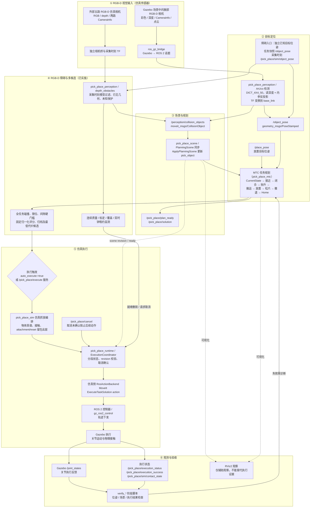

# RM65B Pick & Place 全流程数据流（当前仿真）

> 适用范围：本图描述仓库**当前已实施**的仿真视觉抓放流程（Ubuntu 22.04、ROS 2 Humble、Gazebo Harmonic），
> 便于维护者快速理解数据从哪里来、经过哪些环节、在哪里被执行以及如何验收。
> 本图**不代表实机验证**：仓库当前不包含 RS485/Modbus 驱动，不授权、也未验证连接 RM65B 实机。
> 2026-10-26 更新：阶段 0—5 已按各自范围验收；RGB-D 障碍感知、场景同步和 MTC 多候选已实施，阶段 6 最终运行状态以[最新复核](../build-reports/2026-10-26-RM65B阶段6RGBD最终复核与碰撞阻塞.md)为准。
> 旧腕部 ArUco 目标定位与新外部五路 RGB-D 障碍感知是不同入口。后者当前使用独立已知目标位姿，不能拼接两条分支的单独结果宣称纯视觉完整抓放通过。

## 全流程数据流

## 读图说明

| 阶段 | 输入 | 输出 / 观测点 |
|---|---|---|
| ① 视觉输入 | Gazebo 腕部 RGB-D 相机 | 彩色图、深度图、内参、点云（经 `ros_gz_bridge` 转 ROS 2） |
| ② 目标定位 | 彩色图 + 深度 + 内参 + TF | `/object_pose`；放置目标 `/place_pose` |
| ③ 场景与规划 | `/object_pose`、`/place_pose` | PlanningScene 中的 `pick_object`；MTC 完整任务解与 `plan_ready` |
| ④ 障碍与多候选 | 外部 RGB-D、采集时刻状态/TF/已知目标 | 已见及未知碰撞体、持续监测、完整任务硬约束、评分归档和选中候选 |
| ⑤ 仿真执行 | MTC 解 + 执行触发 | 控制器经 `gz_ros2_control` 在 Gazebo 中驱动关节与夹爪 |
| ⑥ 观测与验收 | Gazebo 反馈与执行状态 | `/joint_states`、执行状态话题、`verify_*` 脚本结果 |

## 边界与注意事项

- **仅仿真**：整条链路只验证仿真；关节执行反馈来自 Gazebo `/joint_states`，RViz 只用于观察场景和规划轨迹，不能作为执行成功证据。
- **视觉不写场景**：`pick_place_perception` 只发布 `/object_pose` 和标准碰撞体观测；`pick_place_scene` 独立校验观测并写入 PlanningScene。MTC 只消费位姿与场景。
- **目标与环境分开**：本轮目标及已捕获障碍几何冻结，障碍输入质量、覆盖和时效仍持续监测。SceneSync 拒绝向已附着对象反复 ADD；执行前重新核对候选 ID、实际场景、配置/标定、payload 和新鲜起点，运行中失效请求取消并确认停止。
- **隔离范围**：感知、场景和规划可独立启动；公共 runtime 是注入式库。完整抓放/观察/复位流程仍是仿真适配，不额外抽成通用执行平台。
- **未来实机执行**：实机控制后端、标定与验收均为规划中的独立工作，不在本图与当前能力范围内。
- **验收范围**：带障碍固定附着仿真与已有腕部视觉入口分别记录。多候选会保留无解来源，不保证每个抓取方向可解；动态障碍回避、真实接触及实机认证不由本图批准。各阶段结果见[扩展方案](../build-reports/2026-10-22-RM65B带障碍物视觉抓取规划扩展方案.md)。

## 相关文档

- 逐步操作与验证命令：[RM65B Pick & Place 全流程教程](../guide/RM65B_PickPlace全流程教程.md)
- 阶段 0 当前结论：[2026-10-24 范围审查、精简与验收](../build-reports/2026-10-24-RM65B阶段0范围审查精简与验收.md)
- 分阶段范围与验收：[2026-10-22 带障碍物视觉抓取规划扩展方案](../build-reports/2026-10-22-RM65B带障碍物视觉抓取规划扩展方案.md)
