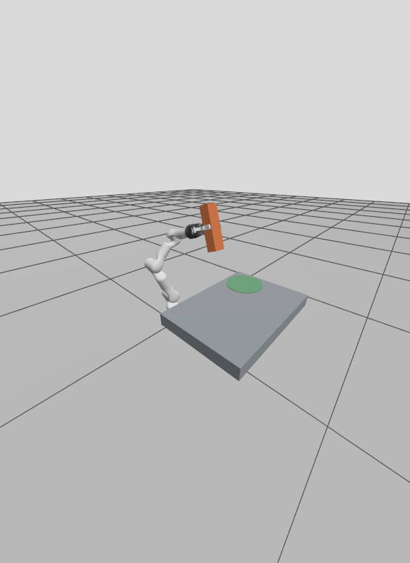
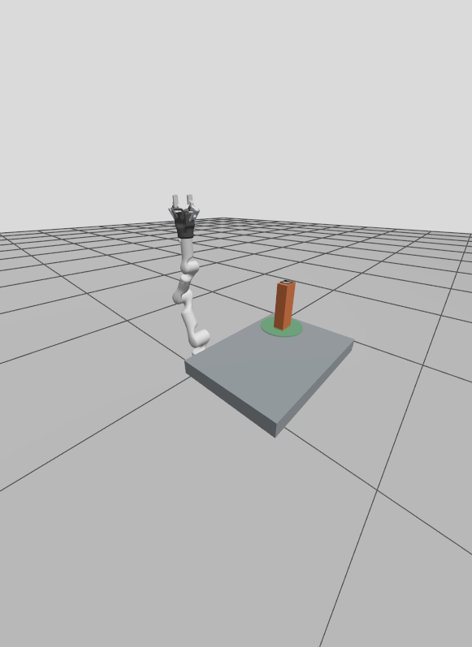
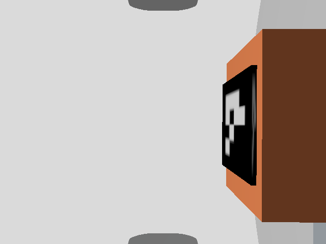

# RM65B Pick & Place 全流程教程

本文用于在有图形桌面上复现完整流程、直接观察 Gazebo/RViz 中的运动，并验证 RGB-D 与视觉定位接口。所有终端都应在 `/home/ww/realman_ws` 下操作。

## 0. 先加载统一环境

阶段 2/3/4/5/6 都依赖本地 Humble MTC 二进制前缀。未加载该前缀时，常见现象是：

- `plan_pick_place` 报 `librviz_marker_tools.so: cannot open shared object file`；
- `execute_pick_place.py` 报 `No module named moveit_task_constructor_msgs`；
- 验证脚本只能看到场景或相机话题，看不到完整任务和执行状态。

在每一个新终端执行：

```bash
cd /home/ww/realman_ws
source scripts/source_pick_place_env.sh
```

脚本会依次加载 ROS 2 Humble、源码构建的 `gz_ros2_control`、工作空间和本地 MTC。可用下面命令确认：

```bash
ros2 pkg executables pick_place_mtc
python3 -c 'from moveit_task_constructor_msgs.action import ExecuteTaskSolution; print("MTC Python OK")'
ldd install/pick_place_mtc/lib/pick_place_mtc/plan_pick_place | grep 'not found' || true
```

最后一条不应输出任何 `not found`。

## 1. 有界面启动和观察窗口

不要使用 `headless:=true`，这样会同时打开 Gazebo GUI 和 RViz2：

```bash
ros2 launch pick_place_sim execute_pick_place.launch.py \
  headless:=false use_rviz:=true auto_execute:=false
```

Gazebo 用于观察真实仿真模型和关节反馈；RViz2 的 MotionPlanning、RobotModel、PlanningScene 用于观察规划场景和规划轨迹。RViz 的绿色/动画轨迹不能代替执行证据，执行是否完成以 Gazebo `/joint_states`、控制器 action 和 `/pick_place/execution_status` 为准。

阶段 3 是最适合第一次直观看全流程的入口：它使用固定/可拆附着，动作可重复，不受物理摩擦随机性影响。规划完成后，在第二终端执行：

```bash
source scripts/source_pick_place_env.sh
python3 scripts/verify_mtc_stage2.py
ros2 service call /pick_place/execute std_srvs/srv/Trigger '{}'
python3 scripts/verify_pick_place_stage3.py
```

也可以直接在启动命令中加 `auto_execute:=true`，但建议第一次使用手动 service，便于在 Gazebo 中确认 Home、接近、闭合、抬升、搬运、放置、打开和返回 Home 的每个动作。

复位后才能重新执行：

```bash
ros2 service call /pick_place/reset std_srvs/srv/Trigger '{}'
```

## 2. 阶段 4：真实接触抓取

阶段 4 不向 Gazebo 发送固定附着命令，而是使用夹爪碰撞、摩擦、质量和接触：

```bash
ros2 launch pick_place_sim physical_pick_place.launch.py \
  headless:=false use_rviz:=true auto_execute:=false grip_target:=0.40
```

先在第二终端验证规划，并启动覆盖完整搬运过程的检查；保持它运行：

```bash
source scripts/source_pick_place_env.sh
python3 scripts/verify_mtc_stage2.py
python3 scripts/verify_pick_place_stage4.py
```

再在第三终端加载同一环境并触发执行：

```bash
source scripts/source_pick_place_env.sh
ros2 service call /pick_place/execute std_srvs/srv/Trigger '{}'
```

不要执行结束后才启动阶段 4 检查，否则无法采到搬运期间的双侧接触及关节状态。

这里必须分别观察：

- `/pick_place/sim/contact_state` 是否包含左右指垫接触；
- `/pick_place/sim/attachment_state` 是否保持 `detached`（真实接触模式不应把它当作成功抓取证据）；
- 搬运后物体是否仍跟随夹爪，最终是否落在放置区。

如果日志出现 `Object slipped in the gripper`，这是物理抓取失败，不是 MTC 规划失败。先用阶段 3 验证上层任务和控制器，再调整 `grip_target`、物体质量/摩擦或运动速度。

阶段 6 可以直接执行视觉定位驱动的抓取任务：ArUco 节点发布 `/object_pose`，MTC 订阅该位姿并生成任务，执行节点在收到完整解后可以自动执行或等待手动触发。但 `verify_pick_place_stage6.py` 只验证视觉位姿和 PlanningScene 同步，不证明抓取、搬运、放置已经成功。阶段 6 默认是 `auto_execute:=true`、真实接触抓取；首次验收建议关闭自动执行，并用固定附着把定位/MTC/控制器链路与接触摩擦问题分开：

```bash
ros2 launch pick_place_sim vision_pick_place.launch.py \
  headless:=false use_rviz:=true auto_execute:=false \
  world_file:=/home/ww/realman_ws/install/robot_gazebo/share/robot_gazebo/worlds/rm65b_pick_place_physical.sdf \
  pick_place_attachment:=true physical_grasp:=false physical_contact:=false
```

该命令打开 Gazebo GUI 和 RViz。相机识别到 marker 后会持续发布位姿并更新 PlanningScene；MTC 在拿到目标位姿和放置位姿后规划。确认 `plan_ready` 为 `true`、阶段 6 验证脚本通过且 Gazebo 中目标位置合理后，在终端 2 手动启动动作：

```bash
ros2 service call /pick_place/execute std_srvs/srv/Trigger '{}'
ros2 topic echo /pick_place/execution_status
ros2 topic echo /pick_place/execution_success
python3 scripts/verify_pick_place_stage3.py
```

阶段 3 verifier 使用 `/place_pose` 中的目标，检查执行成功、Gazebo 最终放置误差不超过 4 cm，以及 Gazebo 和 PlanningScene 均已解除附着；它不依赖专用场景路径，可用于这里的视觉固定附着回归。不要把 `verify_pick_place_stage6.py` 的 PASS 当作动作成功。确认固定附着全流程后，再以 `pick_place_attachment:=false physical_grasp:=true physical_contact:=true` 测真实接触；接触失败需要结合实际接触、位姿和执行日志诊断。

注意：视觉节点收到 `/pick_place/plan_ready=true` 后冻结当前检测位姿，避免执行中目标估计变化导致场景与已规划轨迹不一致。因此一次执行后如需再次从新图像定位并执行，先结束整套 launch，再重新启动；仅调用 `/pick_place/reset` 不会解除视觉节点的冻结状态。

## 3. RGB-D 相机接口和图像观察

启动 RGB-D 场景：

```bash
ros2 launch pick_place_sim rgbd_pick_place.launch.py \
  headless:=false use_rviz:=true auto_execute:=false
```

接口映射如下：

| 语义 | 话题 | 类型 | 预期 |
|---|---|---|---|
| 彩色图像 | `/camera/camera/color/image_raw` | `sensor_msgs/msg/Image` | `640x480`, `rgb8` |
| 深度图像 | `/camera/camera/depth/image_rect_raw` | `sensor_msgs/msg/Image` | `640x480`, `32FC1` |
| 彩色内参 | `/camera/camera/color/camera_info` | `sensor_msgs/msg/CameraInfo` | 与彩色图像同帧 |
| 深度内参 | `/camera/camera/depth/camera_info` | `sensor_msgs/msg/CameraInfo` | 与深度图像同帧 |
| 点云 | `/camera/camera/depth/color/points` | `sensor_msgs/msg/PointCloud2` | `640x480` |
| 光学帧 | `camera_color_optical_frame` | TF | 可变换到 `base_link` |

命令行检查：

```bash
ros2 topic list | grep -E 'camera|points'
ros2 topic info -v /camera/camera/color/image_raw
ros2 topic echo /camera/camera/color/camera_info --once
ros2 topic hz /camera/camera/color/image_raw
python3 scripts/verify_pick_place_stage5.py
```

直观看图像可使用：

```bash
ros2 run rqt_image_view rqt_image_view
```

在窗口中选择 `/camera/camera/color/image_raw` 或 `/camera/camera/depth/image_rect_raw`。也可以在 RViz2 添加 `Image` display，分别选择彩色和深度话题；添加 `PointCloud2` display 后选择点云话题，Fixed Frame 设为 `base_link` 或 `camera_color_optical_frame`。

阶段 5 的时间戳来自 Gazebo RGB-D 消息，经 `ros_gz_bridge` 转为 ROS 消息。`verify_pick_place_stage5.py` 同时检查消息存在、编码、尺寸、内参、有效深度、点云、光学 TF 和时间戳同步。检查端在各话题最多 30 条消息的缓存中寻找时间匹配的数据组，避免把 GUI 负载下不同时刻到达的首条 RGB/Depth/点云消息直接比较。120 秒内仍没有时间差不超过 0.5 秒且时间戳非零的数据组则失败；这个检查阈值不代表视觉允许 0.5 秒误差，视觉节点的 RGB/Depth 配对仍限制为 50 ms。

## 4. 视觉定位与 `/object_pose`

阶段 6 会在 RGB-D 场景上启动 ArUco 节点：

```bash
ros2 launch pick_place_sim vision_pick_place.launch.py \
  headless:=false use_rviz:=true auto_execute:=false grip_target:=0.40
```

视觉链路为：

1. 彩色图像检测 `DICT_4X4_50` 的 marker ID 0；
2. 从深度图像读取 marker 中心深度；
3. 使用 `CameraInfo` 内参反投影到相机光学坐标系；
4. 用 TF 将点变换到 `base_link`；
5. 减去物体高度的一半得到物体中心；
6. 发布 `/object_pose`，并通过 `ApplyPlanningScene` 更新 `pick_object`；
7. MTC 只消费 `/object_pose` 和 `/place_pose`，不依赖 ArUco 实现细节。

### 4.1 分步验证视觉数据链

在每条命令前确认当前终端已 source 统一环境。先检查节点和发布者，确认启动的是唯一一套仿真，避免旧进程造成 QoS 或重复发布者冲突：

```bash
ros2 node list | sort
ros2 topic list | grep -E '^/camera/|^/object_pose$|^/place_pose$|^/pick_place/'
ros2 topic info -v /camera/camera/color/image_raw
```

依次验证图像、深度、内参和点云是否持续发布：

```bash
ros2 topic type /camera/camera/color/image_raw
ros2 topic hz /camera/camera/color/image_raw
ros2 topic echo /camera/camera/color/image_raw --once
ros2 topic hz /camera/camera/depth/image_rect_raw
ros2 topic echo /camera/camera/depth/image_rect_raw --once
ros2 topic echo /camera/camera/color/camera_info --once
ros2 topic echo /camera/camera/depth/camera_info --once
ros2 topic hz /camera/camera/depth/color/points
```

图像消息重点看 `header.stamp`、`header.frame_id`、`height`、`width`、`encoding`。当前期望彩色为 `rgb8`，深度为 `32FC1`，尺寸均为 `640x480`。再用 `rqt_image_view` 选择彩色和深度话题，肉眼确认 marker ID 0 清晰可见且没有被机械臂/桌面遮挡。阶段 5 verifier 检查 RGB-D 接口与两类相机时间戳；它不检查 ArUco 是否检测到 marker。

确认视觉节点订阅及输出话题 QoS：

```bash
ros2 node info /aruco_object_pose
ros2 topic info -v /object_pose
ros2 topic echo /object_pose --once --qos-durability transient_local --qos-reliability reliable
```

`/object_pose` 类型是 `geometry_msgs/msg/PoseStamped`，当前发布端采用 reliable + transient-local，`header.frame_id` 应为 `base_link`。如果 `ros2 topic info -v` 显示多个发布者，先关闭遗留 launch。遇到 `incompatible QoS ... DURABILITY` 时，检查输出中每个 publisher/subscription 的 durability；不要仅凭 topic 存在判断已经收到消息。可用下面的 TF 命令核对相机坐标到机器人基座的变换：

```bash
ros2 run tf2_ros tf2_echo base_link camera_color_optical_frame
```

阶段 6 的定位计算是：检测 marker 中心像素 `(u,v)`，从当前缓存深度图取该像素深度 `Z`，用相机内参 `fx, fy, cx, cy` 反投影得到相机坐标 `(X,Y,Z)`，再经 TF 转到 `base_link`，按配置的物体高度减去半高得到物体中心。当前拒绝 RGB 与深度时间戳相差超过 50 ms 的图像，使用 RGB 消息时间戳查询 TF，并将该时间戳写入 `/object_pose`。这仍是最新深度缓存配对；移动相机的进一步验证需覆盖时间配对、运动模糊和标记遮挡。

### 4.2 验证 PlanningScene、规划和执行

先验证视觉位姿及 PlanningScene 对象一致：

```bash
ros2 topic echo /object_pose --once
ros2 topic info -v /object_pose
ros2 run tf2_ros tf2_echo base_link camera_color_optical_frame
python3 scripts/verify_pick_place_stage6.py
```

正确结果应满足：`/object_pose.header.frame_id == base_link`，位置非零，PlanningScene 中存在 `pick_object`，且视觉位姿与 PlanningScene 位置误差小于检查阈值。接着检查 MTC 的输入和输出：

```bash
ros2 topic info -v /place_pose
ros2 topic echo /place_pose --once
ros2 topic echo /pick_place/plan_ready --once
ros2 topic echo /pick_place/task_description --once
ros2 topic info -v /pick_place/solution
```

只有 `plan_ready: true` 且 solution/task description 已发布，才能认为完整任务规划就绪。建议阶段 6 首轮使用 `auto_execute:=false`，确认 RViz/Gazebo 里的目标与规划合理后再执行。真实接触模式先在单独终端运行 `python3 scripts/verify_pick_place_stage4.py`；固定附着模式改用 `python3 scripts/verify_pick_place_stage3.py`。保持检查运行，再在另一个终端触发：

```bash
ros2 service call /pick_place/execute std_srvs/srv/Trigger '{}'
ros2 topic echo /pick_place/execution_status
ros2 topic echo /pick_place/execution_success
ros2 topic hz /joint_states
ros2 topic echo /pick_place/sim/attachment_state
ros2 topic echo /pick_place/sim/object_pose
```

执行时 Gazebo 窗口应能看到机器人关节实际运动；`/joint_states` 应持续更新，执行状态应经过各段并最终报告成功。固定附着模式下还应观察 attachment 从抓取后 attached，释放/收尾后 detached，物体最终位姿落入放置区域。真实接触模式不要用 attachment 状态作为抓取成功证据，应看夹爪接触和搬运后的 Gazebo 物体位姿。规划成功只代表 MTC 已生成解，不代表物体已经完成抓取。

## 5. MTC 任务接口和执行状态

MTC 节点 `pick_place_mtc/plan_pick_place` 将任务拆为：

```text
Home
  -> Pre-Grasp (OMPL)
  -> Approach (Cartesian)
  -> Close Gripper
  -> Attach in PlanningScene
  -> Lift (Cartesian)
  -> Transport (OMPL)
  -> Place (Cartesian)
  -> Open Gripper
  -> Detach in PlanningScene
  -> Retreat (Cartesian)
  -> Home
```

接口分类：

| 接口 | 类型 | 作用 |
|---|---|---|
| `/object_pose` | `PoseStamped` | 目标物体位姿；可来自已知场景或视觉 |
| `/place_pose` | `PoseStamped` | 放置目标位姿 |
| `/pick_place/task_description` | MTC `TaskDescription` | 任务阶段和 stage ID |
| `/pick_place/solution` | MTC `Solution` | 规划出的子轨迹序列 |
| `/pick_place/plan_ready` | `Bool` | 完整 MTC 解已发布 |
| `/pick_place/execute` | `std_srvs/srv/Trigger` | 执行一次已发布方案 |
| `/pick_place/reset` | `std_srvs/srv/Trigger` | 重置 Gazebo 物体和 PlanningScene |
| `/pick_place/execution_status` | `std_msgs/msg/String` | 当前执行阶段和失败原因 |
| `/pick_place/execution_success` | `Bool` | 一轮执行最终结果 |
| `/joint_states` | `sensor_msgs/msg/JointState` | Gazebo 真实关节反馈 |

检查顺序建议是：

```bash
ros2 topic echo /pick_place/plan_ready --once
ros2 topic echo /pick_place/task_description --once
ros2 topic echo /pick_place/execution_status
ros2 topic echo /pick_place/sim/contact_state
ros2 topic echo /pick_place/sim/object_pose
ros2 topic echo /joint_states
```

如果看到 `New publisher discovered ... incompatible QoS ... DURABILITY`，先用 `ros2 topic info -v /object_pose` 查看发布者。当前已知场景和视觉节点统一使用 reliable + transient-local；如果仍有旧进程残留，应先关闭旧的 ROS 2/Gazebo 进程后重新启动。

## 6. 推荐的全流程验收顺序

1. 先用阶段 3 + `headless:=false` 验证能在 Gazebo/RViz 中看到完整动作，并通过 `verify_pick_place_stage3.py`。
2. 再用阶段 4 验证真实接触和重复抓取；物理滑落只归类为接触参数问题。
3. 启动阶段 5，先在 `rqt_image_view` 中确认彩色/深度画面，再运行 `verify_pick_place_stage5.py`。
4. 启动阶段 6，依次检查相机消息、marker 检测后的 `/object_pose`、PlanningScene、MTC `plan_ready`；再调用 `/pick_place/execute`，从 execution status 和 Gazebo 反馈确认动作完成。
5. 最后才使用 `auto_execute:=true` 做连续回归；每轮失败后先调用 `/pick_place/reset`，不要在执行中重启视觉节点或重复发布目标位姿。

## 7. 多候选规划与腕部相机增量验证（2026-10-12）

MTC 现在默认请求 5 个完整候选任务，按六个机械臂关节的加权累计移动量选解：`cost = sum(weight[j] * abs(q[k+1,j] - q[k,j]))`。权重依次为 `[5, 4, 3, 2, 1, 1]`，底座和近端运动开销较大。统计实际轨迹采样点，也累计相邻任务段边界的变化；有界关节直接计算角度差，避免将长转动误算成跨越 ±π 的短路程。夹爪开合不纳入六轴评分。

```bash
ros2 launch pick_place_mtc plan_pick_place.launch.py \
  headless:=false use_rviz:=true planning_candidates:=5
```

每次启动只进行一轮候选规划和选解，候选仍由 OMPL/MTC 采样生成，因此不保证各次结果完全相同或达到全局最优。`planning_candidates` 可设为 3～5（代码允许 1～20）。候选增加会增加规划等待时间；不要把该参数理解为执行次数。完整解不足时只能在已找到的解中选择。

```bash
ros2 topic echo /pick_place/planning_metrics --once \
  --qos-durability transient_local --qos-reliability reliable
```

该 `std_msgs/msg/String` 接口包含权重、每个候选的评分和零起算的 `selected` 下标。当前一次仿真回归评分为 76.590431、76.590837、76.557578、80.769549、82.587310，选择下标 2；阶段 2 验证和两个 `verify_realman_*` 运行时检查通过。该指标仅衡量关节运动量，尚未加入速度、耗时、间隙和接触稳定性。

自动核对至少三个候选、最低分下标以及实际发布的六轴轨迹评分：

```bash
python3 scripts/verify_mtc_candidate_selection.py --min-candidates 3 --timeout 300
```

该检查重新累计所选轨迹的关节移动量，并与指标中的所选分数比较。其余候选只发布分数，检查它们是有限值且所选分数最小，不能独立重算未发布的候选轨迹。候选不足三个会失败，即使阶段 2 已通过也不能据此声称完成了三到五个候选的对比。

相机模式通过 `wrist_camera:=true` 切换。默认 `false` 保留俯视独立相机；`true` 时相机集成在机器人模型中，停止创建独立俯视模型和 `world -> camera_color_optical_frame` 静态 TF。相机中心固定在 `Link6` 局部坐标 `(0, 0, 0.10)`，光轴沿 `Link6` 正 Z，光学帧仍按 Z 向前、X 向右、Y 向下使用。当前末端参考是法兰 `Link6`，不是已有 `ctm2f110_tool0` TCP（TCP 在法兰正 Z 14 cm 处）。

```bash
ros2 launch pick_place_sim rgbd_pick_place.launch.py \
  wrist_camera:=true headless:=false use_rviz:=true auto_execute:=false
ros2 run tf2_ros tf2_echo Link6 camera_color_optical_frame
ros2 run tf2_ros tf2_echo base_link camera_color_optical_frame
ros2 topic echo /camera/camera/color/camera_info --once
ros2 run rqt_image_view rqt_image_view
```

法兰到光学帧应固定为 10 cm，基座到光学帧应随腕部运动变化。图像桥接话题与第 3 节相同。坐标换算使用 `p_base = R_base_camera(t_image) * p_camera + t_base_camera(t_image)`；机械臂运动时必须使用图像采集时间的动态 TF。

当前已验证 URDF 转 SDF 保留原生 `rgbd_camera`、CameraInfo 发布及 10 cm TF。初始 ready 姿态没有有效桌面深度；进入下述观察位后，阶段 5 腕部模式、ArUco 定位和完整 MTC 规划均已通过。闭合目标 0.50、主驱动 effort 5 N·m 的可选弹簧胶垫模型曾通过一次完整腕部视觉纯接触抓取，放置误差 8 mm，但同参数全新启动复测在下降时滑移；不能认为它已经稳定，胶垫弹簧继续默认关闭。实验详情见当日构建报告。

后续 2 N·m、`grip_target:=0.55 pad_compliance:=true transport_keep_orientation:=true transport_orientation_tolerance:=0.6` 实验曾完整通过一次（放置误差 9 mm），但相同参数复测搬运滑移 95 mm；物理步长减为 0.5 ms 后仍滑移 45 mm。进一步降为 1 N·m、启用关节空间搬运约束的首轮完整通过，搬运漂移 7 mm、放置误差 19 mm，仍须复测。目前源码的物理主驱动 effort 为实验性 1 N·m、物理世界步长为 0.5 ms；上述可选参数没有全部设为默认，默认闭合目标仍为 0.40，胶垫弹簧与搬运姿态约束仍关闭。观察位和视觉验证通过不意味着这些接触配置已稳定。

`vision_pick_place.launch.py wrist_camera:=true` 会先启动 `wrist_observation`：通过夹爪轨迹 action 张开至 `0.8 rad`，确认执行成功，再通过 MoveGroup 规划并执行观察姿态。到位后发布 `/pick_place/observation_ready=true`，视觉节点才接受图像。机器人出生时仍使用原有安全关节姿态；启动后的第一个任务动作是进入观察位，不能在出生姿态就接受视觉目标。

默认观察 TCP 为 `base_link` 下 `(0.36, -0.18, 0.67) m`，四元数按 `(x,y,z,w)` 为 `(0.5, 0.5, 0.5, 0.5)`，即 `Ry(90°) * Rz(90°)`。光学轴仍朝基座 +X、保持平视；绕光轴旋转腕部使张开的夹指改变遮挡方向，同时更接近物体以增大标记投影。镜头高于立柱顶面，因此能够看到顶面标记。相机仍固连于法兰局部 Z +10 cm，没有移动安装点。这是启动后执行的观察 TCP 目标，不是相机安装坐标，也不是修改机器人出生关节状态。朝向容差收紧为各轴 `0.01 rad`，避免宽容差让实际镜头仰视。

旧的 `z=0.69 m`、四元数 `(0, 0.70710678, 0, 0.70710678)` 曾识别成功，但复测存在规划失败和标记视角不稳定。`z=0.65 m` 配合俯视 5° 虽执行到位，标记仍过度压缩、识别失败；不能将“略俯视”直接等同于可定位。中间姿态 `(0.30,-0.18,0.68)` 配合旋转腕部曾通过阶段 5/6/2，但静置后 marker probe 失败，不作为稳定默认。最终 `(0.36,-0.18,0.67)` 到位静止后连续三次 marker probe 成功，阶段 5 腕部检查通过。尚未证明所有模型和多次重启都稳定，修改物体位置后必须重新检查视野与可达性。

观察位置和朝向已作为统一视觉 launch 的参数开放。以下命令保留窗口并先验证定位，暂不自动抓取：

```bash
source scripts/source_pick_place_env.sh
ros2 launch pick_place_sim vision_pick_place.launch.py \
  headless:=false use_rviz:=true wrist_camera:=true auto_execute:=false \
  observation_xyz:='[0.36, -0.18, 0.67]' \
  observation_quaternion:='[0.5, 0.5, 0.5, 0.5]'
```

在另一个加载相同环境的终端，逐项检查：

```bash
# 必须为 true：运动成功后才发布，支持后启动的检查端读取。
timeout 30s ros2 topic echo /pick_place/observation_ready std_msgs/msg/Bool \
  --qos-durability transient_local --once
# 图像必须看到目标及完整顶部标记；不是仅有夹爪或灰色背景。
ros2 run rqt_image_view rqt_image_view /camera/camera/color/image_raw
```

图像窗口保持打开；其余检查在新终端分别执行：

```bash
python3 scripts/probe_pick_place_marker.py
python3 scripts/verify_pick_place_stage5.py --wrist-camera
python3 scripts/verify_pick_place_stage6.py
ros2 topic echo /object_pose geometry_msgs/msg/PoseStamped \
  --qos-durability transient_local --once
```

marker probe 成功只证明可见性，阶段 6 还必须证明图像时间的动态 TF 转换及 PlanningScene 同步；实际抓取搬运仍须执行回归。一次执行通过不能代替接触抓取的重复性验收。观察失败时不会发布 ready，视觉和 MTC 等待超时属于上游观察失败的结果。

调姿时区分三个量：`observation_xyz` 是工具 TCP 的位置；`observation_quaternion` 是 TCP 在基座下的朝向；`Link6 → camera_color_optical_frame` 是固定安装变换。用以下接口检查真实反馈的光学轴，不能只看 RViz 摄像机视角：

```bash
ros2 run tf2_ros tf2_echo base_link camera_color_optical_frame
ros2 topic echo /joint_states --once
python3 scripts/verify_mtc_stage2.py
```

光学帧的 +Z 是看向物体的方向，+X 向图像右侧、+Y 向图像下方；`base_link` 下方向为 TF 旋转矩阵的第三列。默认应近似 `(1, 0, 0)`；略微俯视时方向的基座 Z 分量应小于零。控制器有跟踪误差、规划有姿态容差，所以以实时 TF 和 RGB 画面共同判断。图像旋转 90° 是腕部调整的结果，不代表光学轴改为俯视。当前 ArUco 放在顶面，必须保留足够的顶面投影面积和四角完整性。

调整顺序：先用默认参数验证平视观察；再根据 RGB 图像调整 TCP 平移，使完整标记留在视野内；最后如有需要增加少量俯角，每次都重新检查 marker、有效深度和阶段 6。相机位置由工具位姿与固定安装变换共同决定，不能直接把镜头期望位置填写为 `observation_xyz`。ready 查询超时应先检查启动日志中的 `Wrist observation reached` 或观察节点报错；不要仅因话题查询超时就触发抓取。完成定位后相机随腕部抓取运动，观察姿态只约束启动定位阶段，不要求抓取过程中一直平视。

观察到位的 ready 只代表 MoveGroup 执行成功，不代表已检测到标记。确认 marker、阶段 5/6、阶段 2 均通过后，再按第 4.2 节先启动执行 verifier、再调用 `/pick_place/execute`。不要同时启动多个 `wrist_observation` 或多个仿真；重新调姿测试应停止原观察节点，避免旧的 latched ready 与新观察结果混用。MTC 发布 plan_ready 后视觉位姿冻结，调姿或更换物体后的重新定位应重新启动本轮环境，避免沿用旧规划。

最终默认的全新启动复核：自动观察到位，marker probe、阶段 5、阶段 6（Gazebo 误差 7 mm、PlanningScene 同步 0 mm）、阶段 2 均通过。该轮没有触发抓取执行，接触稳定性与 GUI 观看效果仍分别待验收。

2026-10-12 再次全新启动复核：沿用上述默认观察位，关闭自动执行，阶段 5、阶段 6、阶段 2、marker probe 和两个控制器运行时检查全部通过。相机 RGB 截图显示完整 ID 0 标记位于画面右侧，夹指在上下边缘；目前能定位，但目标尚未居中。保持平视并不自动保证取景居中，移动物体后应同时调整 TCP 平移和朝向，并重新检查图像。

阶段 6 默认必须收到 `/pick_place/sim/object_pose` 的 Gazebo 真值，要求视觉位置误差不超过 20 mm、PlanningScene 同步误差不超过 15 mm。本轮分别为 7 mm 和 0 mm。只有显式添加 `--planning-only` 才跳过真值要求；该模式不能作为定位精度验收。应在观察到位、尚未抓取时运行此检查，避免把冻结的抓取前视觉位姿与搬运后的物体真值比较。

相机安装变换修改后，观察目标不会自动求解。当前参数已按法兰 Z +10 cm 的安装设置配套调整；如果再次改变安装位置/朝向，必须重新选取 `observation_xyz` 和 `observation_quaternion`。保留原出生关节姿态，通过无碰撞规划移动到观察位，可避免直接修改出生姿态造成模型与控制器初始状态不一致。

本轮实测镜头位置约 `(0.3202,-0.1807,0.6655) m`，光学 +Z 方向约 `(0.99994,-0.00898,0.00668)`，即近似平视，含约 0.38° 的微小仰角，处于规划/执行误差范围；不是严格俯视。这里采用已通过标记检测的平视目标。若要求实际 Z 方向严格为负，应另行调整朝向并复核标记可见性，不沿用本次通过结论。

### 7.1 夹爪反馈与物理胶垫诊断

当前推荐的立柱接触配置（1 N·m、0.5 ms；四次全新启动完整通过，后两次验证修正后的 Transport 超时配置，第四次启用 GUI）如下。启动前停止其他仿真，所有命令从工作空间运行并加载同一环境：

```bash
source scripts/source_pick_place_env.sh
ros2 launch pick_place_sim vision_pick_place.launch.py \
  headless:=false use_rviz:=true wrist_camera:=true auto_execute:=false \
  grip_target:=0.55 pad_compliance:=true \
  transport_keep_orientation:=true transport_orientation_tolerance:=0.6
```

另一个终端检查，按顺序执行；规划可能需要数分钟。图像窗口可按第 3 节另开：

```bash
source scripts/source_pick_place_env.sh
python3 scripts/verify_mtc_stage2.py --timeout 900
python3 scripts/verify_mtc_candidate_selection.py --min-candidates 3 --timeout 900
python3 scripts/verify_pick_place_stage5.py --wrist-camera
python3 scripts/verify_pick_place_stage6.py
python3 scripts/verify_mtc_transport_orientation.py --tolerance 0.6 --check-yaw
# 必须在触发之前启动，保留本终端观察完整过程。
python3 scripts/verify_pick_place_stage4.py
```

第三轮使用修正后的 pre-grasp 10 秒、受约束 Transport 30 秒配置，从观察 ready 到完整任务发布约 581 秒。300 秒 verifier 超时后，规划仍继续并最终发布五个完整候选。因此此处检查允许等待 900 秒；这是检查等待上限，不是规划耗时保证，也没有放宽通过条件。检查超时后先看规划进程和日志，不能直接当作规划终止或触发执行。当前规划耗时仍是待优化项。该轮实际接触执行全部通过并返回 Home：搬运漂移 6 mm、放置误差 8 mm、场景同步 0 mm、1851 搬运关节样本 mimic 最大误差 0.005944 rad。没有使用强制附着。

确认上述规划/定位检查均通过、阶段 4 verifier 正在等待后，在第三终端触发：

```bash
source scripts/source_pick_place_env.sh
ros2 service call /pick_place/execute std_srvs/srv/Trigger '{}'
```

两轮实验搬运漂移分别 7/3 mm、放置误差 19/17 mm，受载 mimic 最大偏差 0.0067/0.0046 rad。此配置是胶垫弹簧、减小驱动力与姿态受限 OMPL 的组合效果，尚未通过单因素实验区分各自贡献，也不是实物胶垫参数标定。保持验收门限不变，不以一次或两次成功代替所有工作空间、GUI、不同物体的稳定性证明。每次全新启动重新采样规划；复用旧任务重复执行还须确认机器人起点和冻结视觉输入有效。

MoveIt 中的 mimic 关系用于理想连杆规划；反馈 TF 使用 `/joint_states` 的 Gazebo 实测角度，反馈模型通过 `/robot_description_feedback` 发布。因接触约束产生的实际连杆偏差不会再被 TF 中的理想 mimic 关系覆盖。运动过程中另开终端执行只读检查：

```bash
python3 scripts/verify_gripper_feedback_tf.py --duration 120
```

应输出 `PASS measured gripper TF`。它检查六个夹爪关节的同时间戳 TF 与实测角度是否一致；输出的 `actual mimic error` 则反映物理连杆相对理想关系的偏差，两者含义不同。阶段 4 检查还输出搬运期最大 mimic 偏差、可选胶垫行程与双侧接触样本数。

`pad_compliance:=true` 是局部 X 方向被动弹簧支撑胶垫：名义 ±2 mm、5000 N/m、19 N·s/m。它近似胶垫支撑柔顺性，不模拟真实橡胶形变。早期 5/2 N·m 的弹簧胶垫复测有滑移；当前 1 N·m 配套参数已有四轮通过，不单独推广胶垫选项或未测试的闭合目标。这里测试闭合目标为 0.55，尚未覆盖所有物体尺寸。

相关分类和阶段边界见 [RM65B Pick & Place 长时目标任务分类](RM65B_PickPlace长时目标任务分类.md)。

### 7.2 搬运速度与可选姿态约束

物理/视觉启动链的自由空间 Transport 默认速度比例为 `transport_velocity_scaling:=0.15`、加速度比例为 `transport_acceleration_scaling:=0.10`。它们只影响 Transport 的规划时间参数，不能保证夹持稳定。`transport_keep_orientation:=false` 保持无姿态约束的 OMPL 搬运；可选启用时，`transport_orientation_tolerance` 限制固定参考系中旋转向量的三个分量，包含偏航。0.2 rad 的窄约束曾规划超时；0.6 rad 配合姿态空间采样曾生成通过 FK 检查的解，但另一次全新启动全部路径最终校验无效。当前启用约束时使用关节空间插值，并将该 MTC Connect 的总超时设为 30 秒（无约束仍 10 秒）；新实验得到五个完整候选，所选 50 路点通过三轴 FK 检查。约束仍默认关闭，规划成功与接触搬运稳定性分别验收。

```bash
# 在已有完整规划、尚未执行时检查所选 Transport 的 FK 路点姿态。
python3 scripts/verify_mtc_transport_orientation.py --tolerance 0.2
# 实验约束模式：连同偏航一起检查，必须匹配启动时的容差。
python3 scripts/verify_mtc_transport_orientation.py --check-yaw --tolerance 0.6
# 受约束多候选规划可能超过原 60 秒等待；不改变通过条件。
python3 scripts/verify_mtc_stage2.py --timeout 900
```

该脚本仅检查所选解的离散路点，不验证控制器插值、实际受载姿态或全部候选。姿态通过仍不能替代阶段 4 的真实搬运验收；第 7.1 节配套配置已通过四次立柱接触执行，其他物体和参数需重新验收。

放置目标改用标准 MTC `GeneratePose`，严格采用 `/place_pose` 的朝向；`ComputeIK` 仍使用附着物体作为 IK frame，保留夹持变换。原 `GeneratePlacePose` 会采样长方体的 180° 对称朝向。无约束 OMPL 即使起终点朝向相同，路径中间仍可能大幅转腕；验证脚本新增起终点旋转向量输出，不能仅从最大偏航误差推断终点发生了半圈变化。

### 7.3 带界面执行与实际画面

2026-10-12 使用第 7.1 节命令全新启动，Gazebo、RViz 和 `rqt_image_view` 窗口均存在，阶段 5/6/2、五候选评分及 Transport FK 检查通过。观察 ready 后约 245 秒发布完整任务，评分 `85.317808 / 89.546324 / 103.852293 / 89.545680 / 114.588331`，选中下标 0。纯接触执行通过并返回 Home：抬升漂移 2 mm、搬运漂移 8 mm、放置误差 4 mm、直立倾角 0、PlanningScene 同步 0 mm。受载 mimic 最大偏差 0.028254 rad；动态反馈 TF 110 秒六关节各 8201 样本通过，变换误差约零。GUI 负载下物理连杆仍有小幅偏差，反馈 TF 准确并不意味着偏差为零。

Gazebo 默认视角离场景较远，可在加载环境的另一个终端调用标准 GUI 接口设置近景。这里修改的是观看仿真的相机，腕部 RGB-D 安装和视觉 TF 保持独立：

```bash
gz service -s /gui/move_to/pose \
  --reqtype gz.msgs.GUICamera --reptype gz.msgs.Boolean --timeout 10000 \
  --req 'pose: { position: { x: 0.95 y: -0.7 z: 0.95 } orientation: { x: -0.21887132 y: 0.09544311 z: 0.89012409 w: 0.38815598 } }'
```

Gazebo 自带截图接口可保存当前 3D 渲染图，避免 WSLg 窗口截图为黑色。输出路径必须是已存在的目录；返回 `data: true` 表示请求已接受，下一次渲染才写入带时间戳的 PNG：

```bash
gz service -s /gui/screenshot \
  --reqtype gz.msgs.StringMsg --reptype gz.msgs.Boolean --timeout 10000 \
  --req 'data: "/tmp"'
```

以下截图来自本轮实际运行，已查看确认物体抬离工作台、最终直立放在绿色区域，机械臂返回安全姿态。它们是不同执行时刻的 Gazebo 渲染图，完整执行结果以阶段 4 与控制器反馈为准。





腕部 RGB 中完整 ID 0 可见但偏右，可通过图像窗口检查取景。抓取过程中相机随腕部移动，图像变化正常；本版在规划就绪后冻结目标位姿，用抓取前图像时间的 TF 计算基座下目标。


