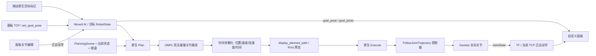

# RM65B 仿真工作流与接口说明

更新日期：2026-10-27。适用工程：本仓库 `realman_ws`，Ubuntu 22.04 / ROS 2 Humble / Gazebo Harmonic。

本文承接原根 README 的环境、架构、场景和验收说明，并解释当前代码真正连接起来的完整仿真流程。日常启动、发布和查看命令集中在 [README](../../README.md)。`Panda联合仿真.md` 等文件是其他机器人/历史环境的参考资料，不能替代本工程的启动入口。

## 先分清三种操作

1. **普通 A→B**：拖动 RViz 目标，或者把末端/关节目标输入面板；MoveIt 求解并规划，用户点击原生 Plan、Execute 后机械臂移动。它不自动识别、夹取、搬走物体。
2. **Pick & Place**：MTC 编排预抓取、接近、闭爪、附着、抬升、搬运、放下、松爪、分离、撤退、Home。它有独立的 `/pick_place/execute` 服务。普通面板目标不会自动改写一个已经生成的 MTC 任务。
3. **感知/场景更新**：相机和识别节点只提供物体/障碍的观测，SceneSync 把观测同步到 MoveIt。图像正常、场景就绪、规划成功、执行成功、物体确实放到了位置，是五个不同的检查结果。

本仓库不含已验收的 RM65B 实机执行后端。夹爪厂商 SDK 是上游 SDK 加项目位置适配/回读扩展；`dry_run` 通过不代表串口和真实夹持已经验证。

## 从启动命令开始，实际加载了什么

以 `ros2 launch pick_place_demo known_scene.launch.py with_gripper:=true` 为最容易观察的入口。`known_scene.launch.py` 包含基础 `realman_moveit_gz.launch.py`，再增加已知场景节点。

| 启动部分 | 加载内容 | 对下一环节的作用 |
| --- | --- | --- |
| Xacro/URDF | RM65B、夹爪、法兰/TCP、腕部相机外形、关节和碰撞几何 | 为 Gazebo、TF、MoveIt 提供统一的链式结构，但仿真 URDF 另带 Gazebo 控制插件 |
| SRDF/kinematics/limits | `rm65_arm`、`hand`、命名姿态、IK 插件、关节速度/加速度和位置范围 | 告诉 MoveIt 哪些关节一起规划、如何求 IK、规划允许的边界 |
| Gazebo world | 地面/桌面/物体、灯光、所选场景传感器；不同入口选不同 SDF | 生成实际仿真状态、图像和接触，而不是 RViz 中的动画 |
| ros_gz_sim + spawn | 启动 Harmonic，插入机器人；先暂停配置 | 避免模型未准备好时控制器先运行 |
| gz_ros2_control + controller_manager | `joint_state_broadcaster`、`rm65b_arm_controller`、`ctm2f110_hand_controller` | 激活后接收位置轨迹，推进仿真关节，并发布实际反馈 |
| robot_state_publisher | URDF + `/joint_states` | 正运动学得到 `/tf`，固定安装关系放到 `/tf_static` |
| ros_gz_bridge | 基础入口桥接时钟；RGB-D 入口另桥接 RGB、depth、CameraInfo、点云 | 把 Gazebo Transport 消息转成 ROS 标准消息，ROS 节点不用读 Gazebo 私有数据 |
| move_group | RobotModel、PlanningScene、OMPL、轨迹时间参数化、MoveIt 控制器映射 | 提供 IK/FK、碰撞检查、规划 action 和执行 action |
| RViz MotionPlanning | 模型、场景、规划路径、交互标记、原生 Plan/Execute | 展示与编辑 MoveIt 的查询目标；RViz 本身不产生 Gazebo 关节反馈 |
| RM65B Operator 独立插件 | 当前反馈、目标/IK、限制、物体坐标、任务触发 | 把原来散在后端的信息集中展示，操作仍交给原生 MoveIt |
| target_pose_executor | 兼容原终端位姿入口 | `/manipulation/rm65b/target_pose` 一到就规划并执行，与新面板的预览入口不同 |
| known_scene | 桌面/物体碰撞体、`/object_pose`、`/place_pose` | 提供已知物体坐标；这一入口没有把物体位置“识别”出来 |

启动编排是“暂停世界 → 插入机器人 → 配置/激活控制器 → 恢复仿真 → 启动 MoveIt/RViz/目标适配器”。具体启动条件在 `manipulation_bringup/launch/realman_moveit_gz.launch.py`。基础入口不创建 MTC 任务执行器；抓放入口才增加相关节点。

## 普通 A→B 的信息怎么流动



逐步理解：

1. **输入末端坐标**：位置以米为单位，姿态可在面板用弧度 RPY 编辑，ROS 消息使用单位四元数。`header.frame_id` 指明在哪个坐标系表达。面板把有效 TF 下的输入转换到 `base_link`，再转换到 MoveIt 模型坐标。
2. **IK**：给定“TCP 应在这里”，求一组使末端到达该位姿的关节角。可能多解、无解、超限或碰撞。新面板用实际关节作为种子，拒绝无解/超限/目标碰撞，不发动作。直接编辑关节时跳过 IK，再由 FK 得到对应 TCP。
3. **已接受目标**：面板调用原生 `MotionPlanningDisplay::setQueryGoalState()`，与原生拖动共用目标状态。`goal_joints` 是目标关节，并非一条完整轨迹。拖动原生标记成功后，也把原生目标回填到面板并发布 `goal_pose/goal_joints`。
4. **Plan**：原生 MoveIt 取起点、目标关节、场景和规划参数，请求 `/move_action`。OMPL 在关节空间找避碰路径；不只是把终点作直线插值。时间参数化再补上每个路径点的速度、加速度和到达时间，输出 `DisplayTrajectory` 供 RViz 展示。
5. **Execute**：用户点击原生执行后，MoveIt 将生成的轨迹通过 `/execute_trajectory` 和控制器映射交给两个 `FollowJointTrajectory` action。夹爪与机械臂各自有控制器。
6. **反馈闭环**：控制器逐点发送位置命令给 Gazebo，Gazebo 实际关节再经 `/joint_states`、TF 和面板返回。`controller_state.desired` 是期望，`actual` 是实际，`error` 是误差。动画到终点、action 成功和实际反馈到位要分开看。

普通 IK 和 OMPL 都运行在进程/服务内部，天然没有“所有内部变量都自动发布”的话题。面板补充了目标前后遥测；`/compute_ik`、`/compute_fk` 仍是独立服务。`/motion_plan_request` 是 MoveGroup 调试发布的 OMPL 实际输入，当前安装版本可用时可直接查看；MTC Cartesian 段不能靠这一个话题覆盖。

## 自定义前端如何安装和使用

实现位于独立 ROS 包 `src/ros2_adapters/rm65b_operator_panel/`，插件类 `rm65b_operator_panel/OperatorPanel`。`scripts/build_operator_panel.sh` 只增量构建插件和项目 RViz 配置；不修改 `/opt/ros`、RViz 或 MoveIt 上游源码。已有 RViz 可手工 Add New Panel；默认 RM65B 配置自动加载。界面只放核心数值、坐标系、单位和按钮；说明留在本文。默认配置不再加载会在当前 WSLg 环境触发 OGRE resize 崩溃的 Camera display，图像用 README 的 rqt_image_view 查看。

中文方框表示当前字体缺少字形。增量构建脚本会先检查中文字体；也可单独运行 `bash scripts/setup_operator_panel_fonts.sh` 后重启 RViz。WSL 优先为当前用户注册本机已有 Windows 中文字体，不复制字体、不改全局字体配置；普通 Ubuntu 安装 `fonts-noto-cjk`。插件只为自己的面板选择中文字体，不修改其他 RViz 控件。无需临时 `FONTCONFIG_FILE`。

面板显示：

- 当前 TCP、已接受目标 TCP：基座 `base_link`，位置 m，RPY rad。
- 当前各关节、目标关节、模型速度上限、请求速度上限、换算后的生效速度上限：rad、rad/s。
- 物体在基座和**当前 TCP**中的位姿；物体来源下拉框显式选择观测 `/object_pose` 或仅仿真 `/pick_place/sim/object_pose`。
- 失败/拒绝原因，以及独立 Pick & Place 服务入口。

带夹爪模型 TCP 为 `ctm2f110_tool0`；裸臂为 `Link6`，两者不能混用。目标输入 `/manipulation/rm65b/set_goal_pose` 只在面板存在时被消费；图形界面退出就没有这个订阅者。原有 `/manipulation/rm65b/target_pose` 仍然是收到即规划执行的兼容入口，**不能把拖动遥测接到该入口**。

| 面板接口 | 类型 | 含义 |
| --- | --- | --- |
| `set_goal_pose` | PoseStamped | 终端到面板的预览目标，只请求 IK |
| `ik_target_pose` | PoseStamped | 本次尝试的 TCP 输入/原生拖动反馈，失败请求也可观察 |
| `goal_pose` | PoseStamped | MoveIt 接受后的 TCP 目标 |
| `goal_joints` | JointState | 同一目标对应的关节角；关节编辑时是直接目标，不声称来自 IK |
| `current_pose` | PoseStamped | 由实际 JointState 正运动学计算的 TCP |
| `object_in_base` / `object_in_tcp` | PoseStamped | 新鲜物体输入转换后的坐标 |
| `planning_limits` | String(JSON) | 请求上限、共同缩放、各关节生效上限和作用范围 |
| `panel_status` | String | 就绪/错误/拒绝/操作结果 |

表中相对话题统一加 `/manipulation/rm65b/` 前缀。输出使用 transient_local；查看时仍需核对时间戳和状态。关节输入需完整、有限且 ROS/稳态时钟均不超过 2 s；过期时当前值显示缺失。物体输入或 TF 过期时不伪造物体坐标。视觉任务可能冻结最初物体观测，冻结后不应继续当成实时持物跟踪；仿真真值的来源在面板中单独标识。

### 速度限制真正在哪里生效

面板不改模型文件，也不假造硬件限速。它为这个 RViz 原生 MotionPlanning 计算一个保守的共同速度缩放：

- 每个请求关节上限除以该关节的模型上限，取最小比例。
- TCP 的平移速度用串联旋转链的几何上界约束：每个关节轴到 TCP 的最大距离，用其下游固定安装平移长度之和作保守上界；将“该距离 × 该关节模型最大速度”累加，再用 TCP 请求速度除以总和。
- 所有约束比例与面板中独立保存的“规划倍率”共同取较小值，写回原生 `velocity_scaling_factor`。因此实际所有关节可能比用户单独填写的上限更慢。面板显示每一项生效值，降低后端的不透明感。

前端取值：关节“请求上限”不超过加载模型的相应上限；TCP 输入范围为 0—2 m/s，0 显示为“不限”，仅取消本面板的 TCP 平移约束，仍受关节与规划倍率约束；规划倍率为大于 0、至多 1 的无量纲比例。TCP 的默认 0.1 m/s 是初始值，不是最大输入值。规划倍率与已经被约束压低的生效倍率分开保存，提高 TCP/关节限值后点击“应用限速”，会按保留的请求重新计算，避免速度只能降低不能恢复。原生倍率控件的编辑也会同步这个请求，约束仍会限制生效值。

模型速度来自 `rm65b_ctm2f110_joint_limits.yaml`（裸臂对应 `rm65b_joint_limits.yaml`），最终以加载的 RobotModel 为准；项目 RViz 配置的初始速度与加速度倍率均为 0.1，YAML 的默认 0.15 不与明确指定的 RViz 倍率再次相乘。短距离动作还可能受原生加速度倍率限制，达不到速度上限。

该方法不寻找最快的逐关节时间参数化，优点是原生 Plan、原生 Cartesian 规划和 Execute 沿用同一份缩放；TCP 限制指平移速度，不是角速度。加速度缩放仍由原生 UI 配置。限制适用于当前 RM65B 的固定串联旋转链和本 RViz 生成的计划；不替代控制器/实机认证，也不约束独立 MTC、旧终端执行器、其他客户端或直接控制器命令。

目标和已应用速度发生变化时，面板使旧预览/执行按钮失效，要求重新 Plan；规划过程中再改目标/限制也不应执行旧计划。改速度或规划倍率后需点“应用限速”，再 Plan/Execute；不会修改正在执行的轨迹。修改关节/TCP 编辑框后需点击对应应用按钮，不能把未应用的数字当成已接受目标。

## 相机到物体，再到场景

1. Gazebo RGB-D 传感器产生 RGB、浮点深度和 CameraInfo；bridge 转成 ROS `Image`、`CameraInfo`、`PointCloud2`。腕部默认前缀 `/camera/camera/`；独立五视角前缀是 `/stage4/camera/`、`/xleft/camera/` 等。
2. `pick_place_perception/aruco_object_pose` 消费同步的 RGB、depth、内参及 TF，识别物体侧面 4x4 ID 1 标记，用深度反投影得到标记位置，再按标记到物体中心偏移恢复物体中心，输出 `/object_pose` 和标准 `CollisionObject`。规划器不需要知道像素和 ArUco 字典。
3. `pick_place_scene/scene_sync` 验证允许的 object ID、几何、帧和输入质量，再写 MoveIt PlanningScene 并回查。`scene_ready` 与 `scene_revision` 告诉任务端该场景已被确认以及属于哪一版；不是只“发出去就算完成”。
4. 已知场景节点直接发布配置中的 `/object_pose`，不经过图像；静态 Gazebo 真值只在明确选择 `gazebo_truth` 的仿真适配端读取。公共感知和 SceneSync 无 Gazebo 依赖。
5. RGB-D 障碍模式输出已见盒及未知禁入盒，保留自过滤、标定、质量、时效和未知空间保护。看见一点表面不意味着知道完整障碍外形。执行时监控输入租约，失效可取消/停止/锁存，不把一张旧深度图当永久可靠。

## 完整 Pick & Place 怎么接起来

`pick_place_sim` 是仿真编排，`pick_place_mtc` 是任务规划，`pick_place_runtime` 是公共执行契约，`pick_place_scene` 是场景同步，`pick_place_perception` 是感知。公共算法不应反向依赖 Gazebo。

1. 启动仿真、控制器、MoveIt、场景和物体/放置输入；需要腕部观察时，独立观察节点先把相机移动到观察位。
2. MTC 等待物体位姿、放置位姿、场景确认和真实起点。它用实际当前状态构建完整任务，普通空间段交 OMPL，接近/抬升/放置/撤退交 CartesianPath。
3. 候选评估保留完整任务及代价/拒绝原因，经硬门槛筛选后发布 `/pick_place/solution`、`planning_metrics`、`plan_ready`。一个可行 IK 或一个 action 成功不能代表全任务成功。
4. 独立执行服务检查候选与场景 revision、模型、文件、规划配置、实际起点等绑定，拒绝过期或被改写的候选。`auto_execute:=false` 只关闭抓放自动执行，不能据此认定所有启动观察动作也关闭。
5. 用户请求 `/pick_place/execute`，执行器按完整解推进，等待每个 action 的实际结果。闭爪时 MoveIt attach 是规划场景语义；Gazebo fixed attachment 是仿真约束，两者分别确认。
6. 固定附着模式通过 DetachableJoint 验证抬升和搬运的状态同步；纯接触入口不使用它，必须依赖物理碰撞和摩擦，并用接触/物体实际运动验证。
7. 放下后松爪、分离、撤退、回 Home，核对 Gazebo 物体实际位姿和 MoveIt world 中物体状态。reset 只恢复场景，不自动使旧候选有效；场景/起点变化需重新规划。

面板单独的任务按钮只是调用已有 Trigger 服务；服务接受不等于执行完成，最终看 `execution_status`、`execution_success` 和完整 verifier。不要同时启动普通终端执行和抓放执行去争用同一个控制器。

## 夹爪位置、接触、抓取力的区别

当前仿真 controller YAML 使用 `command_interfaces: [position]`，状态为 position/velocity。`grip_target` 是模型关节值；它与真实夹爪开口毫米值和指尖夹持力之间仍需标定。`/pick_place/sim/contact_state` 报接触对象/接触状态，不是经过标定的牛顿力传感器。位置驱动关节的 effort 也不等于指尖力。

现有 `changingtek_gripper_driver` 只处理 FollowJointTrajectory 的位置目标与 SDK `setpos/readpos`，没有接线的夹持力命令/反馈接口。README 因此提供控制器、关节和接触查看命令，并明确标注力接口缺失；不能虚构 `/gripper/force` 话题。实机阶段要先确认 CTM2F110E 与现有模型/SDK 的兼容性，再增加带单位、标定和范围检查的独立力接口。

## 启动入口与已验收边界

原 Pick & Place 流水线编号与“带障碍物扩展方案”阶段编号是两条不同的编号序列。

| 入口/系列 | 已有能力与限制 |
| --- | --- |
| 基础/known_scene | 模型、控制器、桌面、物体、已知位姿和 IK 预检；不自动抓物 |
| 原流水线 2：MTC plan | 完整 CurrentState→预抓取→接近→闭爪→attach→搬运→放下→detach→撤退→Home 的规划；规划通过不代表执行 |
| 原流水线 3：execute_pick_place | 零重力、目标无碰撞的固定附着任务，2026-10-26 兼容复测完成整任务和 reset 后场景检查；不证明物理夹持 |
| 原流水线 4：physical_pick_place | 有重力/碰撞的 30 g、50×70×220 mm 物体接触试验；已有搬运回 Home，双侧接触传感器证据仍不稳定，不能宣称全面物理验收 |
| 原流水线 5：rgbd_pick_place | 640×480 RGB/depth/内参/点云/TF 独立传感器检查，不是真实 RealSense 标定 |
| 原流水线 6：vision_pick_place | ArUco 定位/公共场景同步门槛；纯图像目标定位+完整障碍抓放不能继承固定附着验收 |
| 扩展阶段 0 | 2026-10-24 公共算法/标准接口与仿真解耦验收；不是实机验收 |
| 扩展阶段 1—3 | U 台、固定/随机障碍、静态真值刷新/旧解拒绝；默认场景冻结，真值刷新只支持执行前显式静态刷新 |
| 扩展阶段 4 | RGB-D 静态几何、自过滤、未知保护、实际录包/独立回放和误差评估 |
| 扩展阶段 5—6 | 单薄墙+五路外置 RGB-D+独立已知目标+固定附着，完成完整候选、拒绝绑定、完整动作和全程质量监测；不覆盖动态避障/真实夹持/实机 |

阶段 6 的 2026-10-26 w 独立证据保存在本机 `log/stage6-acceptance-20261026w/`（不进 Git）：八类候选、16 条结果/14 条硬有效，四段动作、抓放/分离/撤退/Home，511 条动作诊断正常；3 s 租约、150 ms 配对、80% 深度质量、3 mm mask、每侧 35 mm 膨胀未放宽。退出期 Gazebo 崩溃限制仍见[最终验收报告](../build-reports/2026-10-26-RM65B阶段6RGBD最终复核与碰撞阻塞.md)。

详细历史过程分别见[原完整教程](RM65B_PickPlace全流程教程.md)、[扩展方案](../build-reports/2026-10-22-RM65B带障碍物视觉抓取规划扩展方案.md)、[构建报告索引](../build-reports/索引.md)。

## 扩展方案阶段 6：RGB-D 多候选固定附着任务

以下保留原 README 的高级复现命令。先生成与当前机器人碰撞模型一致的自过滤模型，再生成完整五路配置；不得把仿真误差示例当实机标定。

```bash
cd ~/realman_ws
source scripts/source_pick_place_env.sh
python3 scripts/prepare_stage5_multiview.py \
  --self-filter-model /absolute/path/self-filter.yaml --output-dir /tmp/stage5-views-new \
  --target-pose-topic /pick_place/sim/object_pose --monitor-known-occlusion
# 用生成器打印的实际文件路径替换三个配置；归档与故障文件每轮选新路径：
ros2 launch pick_place_sim obstacle_pick_place.launch.py \
  headless:=true use_rviz:=false auto_execute:=false \
  obstacle_source:=rgbd benchmark:=single_wall \
  perception_config:=/absolute/path/views/stage4.yaml \
  uncertainty_config:=/absolute/path/views/uncertainty.yaml \
  rgbd_sensor_config:="${PWD}/src/ros2_adapters/pick_place_sim/config/sim_multiview_cameras.yaml" \
  rgbd_update_rate:=5 rgbd_width:=640 rgbd_height:=480 \
  grasp_spin:=1.5707963267948966 planning_candidates:=2 \
  candidate_config:="${PWD}/src/ros2_adapters/pick_place_mtc/config/stage6_candidates.yaml" \
  scene_archive:="${PWD}/log/stage6-manual-new/scene" \
  execution_fault_latch_file:="${PWD}/log/stage6-manual-new/fault.json"
# 另一终端；五路输入稳定后，在启动预检 90 s 窗口内捕获：
ros2 service call /perception/capture_obstacles std_srvs/srv/Trigger '{}'
# 此命令明确执行仿真全任务与篡改拒绝检查：
python3 scripts/verify_stage6_candidates.py --timeout 660 \
  --output log/stage6-manual-new/verify --payload-refusal --execute
```

完整阶段 6 验收还包含参数/场景/文件/实际起点/固定标定变化拒绝，不应只重复上面的成功动作。两个已知遮挡选项默认关闭；启用时需采集时刻独立目标位姿，不能用固定任务位姿代替持物跟踪。默认障碍入口停用未消费的腕部图像渲染，但保留相机外形、碰撞和 TF；旧腕部视觉入口仍启用传感器。

公共感知也可独立启动，不负责创建机器人或传感器：

```bash
ros2 launch pick_place_perception obstacles_external.launch.py \
  perception_config:=/absolute/path/perception.yaml use_sim_time:=false
ros2 service call /perception/capture_obstacles std_srvs/srv/Trigger '{}'
```

## 迁移到下一台机器时带走什么

项目自建的模型/MoveIt 配置、公共算法和标准 ROS 接口、RViz 插件、仿真适配及验证脚本都可保存在 Git 中；实机只启动现场批准的那部分。厂商描述与 `gz_ros2_control` 用 `upstream/*.repos` 的锁定提交导入，`rm_description` 保持符号链接；不复制官方/教学工作空间来冒充自研源码。

不上传 `build/`、`install/`、`log/`、`.third_party/`、录包、缓存、环境密钥。保留 SDK 的来源/许可证；预编译 SDK 的架构与目标机器另行核对。真实控制 owner、法兰/相机/TCP 外参、负载惯量、夹爪型号与力控制、停机阈值都必须现场确认，当前仿真结果不会批准硬件运动。

仓库清点和本次 GUI 验证结果见 [2026-10-27 报告](../build-reports/2026-10-27-RM65B操作面板工作流与迁移清点.md)，分级实机步骤继续沿用 [现场验证与标定计划](../build-reports/2026-10-20-RM65B实机验证与标定规划.md)。
