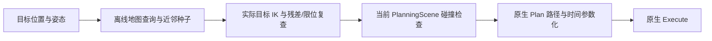

# RM65B 位置—姿态可达性先验与离线建图方案

调研日期：2026-10-27。状态：方法检索与工程方案，**尚未生成 RM65B 可达性地图，也未接入前端或改变执行行为**。

## 1. 结论：两种模式共用一份先验

可以离线整理。对应的成熟方向是 Reachability Map（可达性地图）和 Capability Map（能力地图）[1][2]。
不是分别维护位置范围表和姿态范围表，而是保存“位置与姿态的可达组合”，再按查询条件取切片：

| 模式 | 固定条件 | 返回内容 | 推荐显示 |
| --- | --- | --- | --- |
| 位置基准 | TCP 位置及允许的位置误差 | 此处已发现可达的完整姿态，以及对应关节解 | 接近方向球面与绕工具轴的可用转角 |
| 姿态基准 | TCP 完整姿态及允许的姿态误差 | 保持该姿态时已发现可达的位置 | 半透明空间体素、指定高度切片 |

例如：指定桌面上方一个位置，查看能够从哪些方向接近；锁定夹爪竖直向下的完整姿态，查看能移动到哪些位置。这里只给出功能示例，不提供未经计算的 RM65B 范围数值。

“固定姿态求位置范围”是同一可达性地图的条件查询，不是文献中用于求机器人基座摆放位置的 Inverse Reachability Map。后者才涉及基座位置变化[2]。

### 数学定义

将满足关节限位及所选自碰撞条件的关节配置集合记为 $\mathcal{Q}_{\mathrm{valid}}$，正运动学记为 $f$，则理想的位姿可达集合为：

$$
\mathcal{M}=\{(\mathbf{p},\mathbf{R})\mid\exists\mathbf{q}\in\mathcal{Q}_{\mathrm{valid}},\ f(\mathbf{q})=(\mathbf{p},\mathbf{R})\}.
$$

$\mathbf{p}$ 为 TCP 位置，$\mathbf{R}$ 为完整旋转矩阵，$\mathbf{q}$ 为六个机械臂关节角。两种查询分别为：

$$
\begin{aligned}
\mathcal{O}(\mathbf{p}_0)&=\{\mathbf{R}\mid(\mathbf{p}_0,\mathbf{R})\in\mathcal{M}\},\\
\mathcal{P}(\mathbf{R}_0)&=\{\mathbf{p}\mid(\mathbf{p},\mathbf{R}_0)\in\mathcal{M}\}.
\end{aligned}
$$

实际离线表是这些集合的有限采样近似；任意查询必须同时带上位置和姿态容差。

## 2. 检索到的方法与适用性

| 方法/项目 | 能提供什么 | 对当前工程的判断 |
| --- | --- | --- |
| 经典 Capability/Reachability Map | 空间体素内记录可达姿态；可附可操作度等质量指标[1][2] | **推荐作为第一版数据模型**；同时支持两种切片，不依赖机器人全周对称 |
| Reuleaux | ROS 工具链中的建图、可视化与基座放置；地图可使用树结构[2][3] | 用作算法与文件组织参考；当前上游位于 ros-industrial-attic，不能据此宣称已兼容本工程 Humble |
| DLR-MO reachability_map | 基于 URDF/MoveIt 2 的 FK 采样、Bonxai 体素计数和可视化[10] | 适合参考 ROS 2 模型加载与粗空间图；当前 README 标注开发于 Jazzy，三维计数本身不足以回答固定完整姿态查询 |
| REACH + reach_ros2 | 面向工件/目标集合的 IK、质量评价和可视化；核心与 ROS 插件分开[4] | 工程化参考较合适；面向指定工件的研究不自动等于完整六维工作空间地图；本轮未构建其 Humble 依赖 |
| RM4D | 利用首轴及末轴旋转结构，将六维问题压缩到四维[2] | 内存/生成速度有吸引力，但存在对称假设；可作后续近似排序层，不作为当前硬拒绝依据 |
| RichMap（2026） | 空间网格与姿态测地距离覆盖，支持关节采样建图与批量处理[5] | 值得参考稀疏姿态存储；其自由腕轴/方向简化条件及工具碰撞要单独审查，不能默认球面方向等于完整姿态 |
| 解析 IK / 区间方法 | 解析 IK 可枚举适用机构的分支；区间分析可对特定区域提供内外包络或排除证明[6][7] | 对严格边界更有意义；模型推导与计算成本高，不建议第一版就做全空间认证 |
| MoveIt Cached IK | 保存已求出的解，用邻近解加速下一次 IK[8] | 是缓存，不是完整工作空间边界；可参考其“近邻解作种子”的思路 |

上述项目的性能数字仅是作者各自机器人/数据/硬件上的结果，本方案不据此承诺 RM65B 的耗时、精度或存储量。

## 3. 当前模型决定的前提

本轮核对了仓库中的配置和面板代码：

- 规划组为 `rm65_arm`，参考系为 `base_link`，带夹爪时 TCP 为 `ctm2f110_tool0`。
- `rm65b_kinematics.yaml` 当前使用 KDL 数值 IK，`position_only_ik: false`；一次数值 IK 失败不能证明该位姿不存在解[8]。
- `ctm2f110.urdf.xacro` 定义 TCP 位于夹爪基座局部 Z 方向 0.14 m；机械臂法兰到夹爪的安装变换仍标记为仿真假设。必须按完整变换计算，不能把裸臂法兰工作空间当作 TCP 工作空间。
- `rm65b_ctm2f110_joint_limits.yaml` 的 joint1 为约 ±178°，没有覆盖整周。厂商 xacro 原始限位数值与项目 YAML 还存在差异；建图必须读取并导出**实际加载 RobotModel 的有效限位**，不能只抄任一份文件。
- RM4D 假设首轴能够整周旋转，末轴整周旋转且与接近轴一致[2]。本机不能无条件套用这一假设；作者在部分限位不足整周的机器人上仍取得较好的近似效果，但这不是对本机边界的保证。夹爪、腕部相机和工件碰撞也不能按圆对称处理。
- 面板已经具备 IK、FK、限位和目标碰撞检查。后续地图只是其前置提示/种子来源，现有校验和原生 Plan/Execute 仍作为动作入口。

建图前应冻结模型指纹：展开后的 URDF、SRDF/允许碰撞矩阵、碰撞网格、有效限位、TCP、工具/相机配置与夹爪开度。只有 base_link 在世界中的摆放变化时，可以变换查询；若加入固定桌面等环境，环境层还需要独立更新。

## 4. 推荐生成方法：关节采样 FK + 局部多种子 IK 补洞

### 第一步：离线加载项目模型

复用 MoveIt `RobotModel`、`RobotState` 和 `PlanningScene`。离线工具加载模型、设置夹爪及非机械臂关节状态即可工作，不需要 Gazebo、控制器、相机或实机。MoveIt 提供自碰撞/环境碰撞两类检查[9]。

第一版记录两层：

1. **运动学层**：满足有效关节限位的 FK 样本。
2. **工具配置相关自碰撞层**：机械臂、夹爪、相机的自碰撞过滤结果；必须保存夹爪开度与允许碰撞策略。

桌面、障碍物、附着物体放在在线 PlanningScene 中复查。若需要固定工位专用地图，单独附场景指纹，不替换通用层。

### 第二步：在关节空间采样并做正运动学

用随机/低差异采样覆盖有效关节范围，保存 FK 位姿和关节配置；为限位邻域及任务常用区域增加专门样本。

不建议六关节等间距全组合穷举：假设每轴只取 36 个值，已有 $36^6=2\,176\,782\,336$ 个组合；这只是复杂度示例，不是本机需要的样本量。

每个接受的样本是一个真实的**数值可达见证**：至少存在该关节配置到达其 FK 位姿。它只能证明这一具体样本，不能证明所在整个体素处处可达。

### 第三步：存入空间体素和完整姿态索引

建议空间用稀疏体素，姿态用规范化四元数，或“接近方向 + 绕该方向的转角”完整表示。四元数的正负代表同一旋转，比较必须处理该等价性。

姿态距离采用旋转角距离，避免直接使用欧拉角的普通欧氏距离：

$$
d_R(\mathbf{u},\mathbf{v})=2\arccos\!\left(\min(1,|\mathbf{u}^{\mathsf{T}}\mathbf{v}|)\right).
$$

$\mathbf{u}$ 与 $\mathbf{v}$ 为单位四元数，距离单位为 rad。外层绝对值处理正负等价；实现还应检查有限值并归一化。

仅存接近方向会漏掉绕工具轴的自由度。对两指夹爪，这一转角影响抓取方向、相机和碰撞，不能默认全部可用。

### 第四步：查询切片时对实际目标补 IK

固定位置时，用邻近 FK 样本的关节解作种子，逐个检查候选完整姿态；固定姿态时，在任务区域的位置网格上补 IK。验证求解残差、限位及碰撞，保存不同关节分支。

不要只保留同一位姿的第一组关节解。另一分支可能更接近当前状态，也可能在障碍物变化后仍然有效。近邻样本只是 IK 种子；不能直接把邻格解当成精确目标解。

第一轮建议以任务区域和少量常用姿态做试点，再根据漏检率加密。空间 5 cm 粗图、重点区域 2 cm，以及 $10^5$—$10^6$ 关节样本可作为**待基准测试的起始候选**，不是已验证配置。姿态覆盖密度、容差、超时与种子预算必须随结果一起公开。

## 5. “范围”不能简化为六个互不相关的滑块区间

可达组合通常有孔洞、分叉和不连通区域。分别给出 X/Y/Z 或 roll/pitch/yaw 的最小最大值，只是集合投影，不能表示所有组合都可行。

- 三维凸包会填平孔洞，最多用于概览/粗筛，不能把凸包内部全部标绿。
- 位置锁定模式显示姿态球和工具转角；如保留 RPY 输入，滑块范围应在其他变量固定时重新计算，并允许多个不连续区间。
- 姿态锁定模式显示可达体素或高度切片；拖动到邻格仍需对实际目标验证。
- 仅锁“工具朝下”而允许自转，是部分姿态约束；锁完整四元数是完整姿态约束，两者范围不同，应在接口中明确。

另一个区别是“某个位姿存在一组关节解”和“从当前关节配置可以沿合法路径到达它”。后者涉及 IK 分支、障碍物及连续路径；离线终点表不能替代规划。

## 6. 数据如何整理

建议一个模型对应一份带版本的地图文件。先采用 HDF5 等本地二进制容器即可，不必新增数据库/常驻服务。以下是**拟定字段**，不是已经存在的接口：

| 区域 | 建议字段 | 用途 |
| --- | --- | --- |
| `metadata` | schema 版本、模型/网格/限位指纹、group/base/tcp、夹爪与相机状态、采样 seed、生成器版本、单位、有效范围 | 防止用错模型或工具 |
| `discretization` | 体素原点/边长、姿态表示、覆盖方式、位置/姿态误差阈值 | 解释近似精度 |
| `witnesses` | 位置、四元数（明确 xyzw 或 wxyz）、关节数组、关节名称/顺序、自碰撞状态、FK 残差 | 可追溯到具体解 |
| `position_index` | 体素到见证记录的索引 | 固定位置查姿态 |
| `orientation_index` | 姿态近邻索引到见证记录的索引 | 固定姿态查位置；与前者共用样本 |
| `quality` | 关节限位余量、统一尺度后的 Jacobian 指标、可选碰撞距离 | 排序，不冒充成功概率 |
| `evaluation` | 查询范围/容差、采样预算、IK 尝试/失败记录、独立验证指标 | 解释空白与误判 |

不要把样本出现次数直接叫“到达概率”；关节采样密度、运动学映射和姿态采样分布都会影响计数。Jacobian 的线速度与角速度分量具有不同单位，质量指标需要明确特征长度/归一化约定。

查询结果至少区分：

- **有可达见证**：返回具体位姿/关节解、与请求的残差及容差。
- **未知/尚未找到解**：未覆盖、采样不足或 IK 超时；不能等同不可达。
- **有证明的不可达**：只有几何外包络、适用的完整解析检查或区间排除证明等支持时才能给出。另记录证明条件；不能从空体素自动推导。

可另给“模型不匹配”和“当前场景拒绝”原因，避免把工具变更或碰撞混成运动学不可达。

地图文件若较大，生成在忽略目录中，Git 只存生成配置、脚本、模型指纹和验证摘要；本轮没有生成二进制数据。

## 7. 作为规划先验怎样使用

推荐后续接入顺序：

地图先用作目标提示、抓取候选排序和 IK 种子，不将“表中无记录”升级为禁止规划。若后续要引入硬边界：

1. 先实现按模型推导的保守几何外包络；落在外包络以外才可拒绝。FK 样本包围盒不是这种保证外包络。
2. 若采用区间方法，对关节区间正运动学作可靠包络并细分；无法排除的区域仍为未知。完整姿态、自碰撞与浮点包络条件需要纳入证明[7]。
3. 用户主动限制在一个经验证的任务区域内，是操作策略约束；不能把策略外区域命名为“物理不可达”。

未来前端只需“锁位置/锁姿态”、可达分布和一个简短状态；完整算法说明保留在本文件。拖动继续更新预览目标，Plan/Execute 和独立抓放入口保持原有职责。

## 8. 实现后的验收要求

1. 每个保存见证都可由相同模型 FK 复现；误差、限位、夹爪状态和自碰撞条件可回查。
2. 用未参与建图的关节样本测试覆盖漏检，用独立目标位姿测试预测误判；后者的多种子数值 IK 失败仍只能作数值参考标签，不能充当严格真值。
3. 分别评估两种切片、任务区域/边界/奇异邻域及不同分支；报告容差下的召回、误报、查询耗时、建图耗时和文件大小。
4. 模型/TCP/限位/碰撞网格改变后拒绝错误地图；固定场景层变化不得污染通用运动学层。
5. 表中空白仍能走在线求解；命中地图仍必须通过实际目标和当前场景检查，原生 Plan 验证路径可行性。

**本轮完成的是调研与可实施的数据方案。实际 RM65B 地图覆盖率、两种模式的数值范围、生成时间和 RViz 交互效果仍须建图后独立验收。**

## 9. 一手资料

以下来源检索于 2026-10-27；本文件的工程取舍与试点参数是项目建议，不是引用论文的保证值。

1. Zacharias、Borst、Hirzinger，*Capturing Robot Workspace Structure: Representing Robot Capabilities*，IROS 2007。[DLR 文献记录](https://elib.dlr.de/51226/)。
2. Rudorfer，*RM4D*，arXiv:2410.06968，预印本 2024-10-09，作者项目页列为 ICRA 2025。[论文全文](https://arxiv.org/html/2410.06968v1)；[作者项目](https://mrudorfer.github.io/rm4d/)。
3. ROS-Industrial，[Reuleaux 源码](https://github.com/ros-industrial-attic/reuleaux)及[项目介绍](https://rosindustrial.org/news/2016/10/18/google-summer-of-code-project-workspace-analysis-and-base-placement)。
4. ROS-Industrial，[REACH 核心及插件边界](https://github.com/ros-industrial/reach)；[reach_ros2](https://github.com/ros-industrial/reach_ros2)。
5. Lu、Ma、Pan，*RichMap*，arXiv:2604.06778，2026-04-08。[论文](https://arxiv.org/abs/2604.06778)；[作者源码](https://github.com/YupuLu/richmap)。
6. MoveIt，[IKFast 生成与解析求解器说明](https://github.com/moveit/moveit2_tutorials/blob/main/doc/examples/ikfast/ikfast_tutorial.rst)。只证明工具可供选型，本轮未为 RM65B 生成解析求解器。
7. *Reliable bounding of the implicitly defined sets with applications to robotics*，Procedia Computer Science 186，2021，227–234，[论文与方法摘要](https://www.sciencedirect.com/science/article/pii/S1877050921009571)。该文实验为 2-RPR，不是 RM65B 认证。
8. MoveIt Humble，[KDL、超时/重启与 Cached IK 官方说明](https://moveit.picknik.ai/humble/doc/examples/kinematics_configuration/kinematics_configuration_tutorial.html)。
9. MoveIt Humble，[PlanningScene 自碰撞、完整碰撞及约束检查](https://moveit.picknik.ai/humble/doc/examples/planning_scene/planning_scene_tutorial.html)。
10. DLR-MO，[MoveIt Reachability Maps 源码与适用版本说明](https://github.com/DLR-MO/reachability_map)。本轮只调研，未向 Humble 工程加入依赖。
